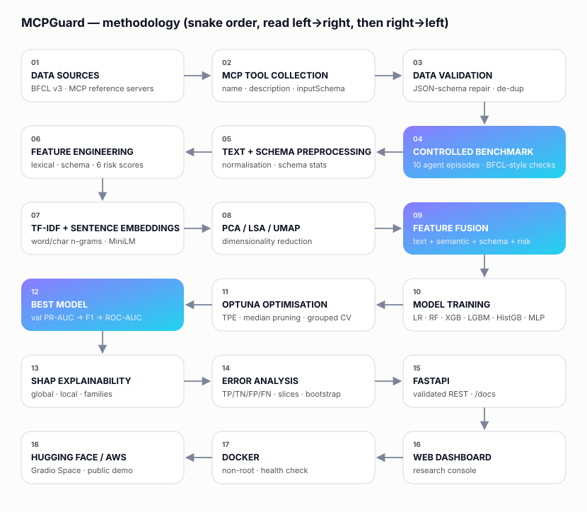

<div align="center">


# MCPGuard

### Predicting Which MCP Tool Descriptions Cause Agent Errors
**An Explainable Machine Learning Framework for Detecting High-Risk Model Context Protocol Tool Descriptions**

*Predict. Explain. Prevent agent failures.*

19MAM56 Advanced Machine Learning Lab · CAT II Project · Coimbatore Institute of Technology

**Live demo:** [nishanth0811-mcpguard.hf.space](https://nishanth0811-mcpguard.hf.space) · **Gradio UI:** [/gradio](https://nishanth0811-mcpguard.hf.space/gradio) · **API docs:** [/docs](https://nishanth0811-mcpguard.hf.space/docs) · **Code:** [GitHub](https://github.com/NishanthAruchamy0927/MCPGuard)

</div>

---

## What it does
AI agents use **Model Context Protocol (MCP)** tools and see each tool only as a **name, a description and a JSON input schema**. Vague wording, undocumented parameters and deeply nested schemas make agents pick the wrong tool, omit arguments or send invalid values.

MCPGuard predicts, **before deployment**, how likely a tool definition is to cause agent errors, explains why with **SHAP**, and suggests concrete fixes.

**How it works**
1. **Data:** 1,579 real BFCL v3 functions (with real user questions and gold calls), 99 MCP reference-server tools and 503 documented augmentations. That gives 2,181 records, or 2,152 after cleaning.
2. **Labels:** a controlled agent benchmark runs 10 simulated agent episodes per tool with BFCL-style call validation. A tool is labelled *error* if 30% or more of its episodes fail.
3. **Features (169):** TF-IDF → LSA (64), MiniLM embeddings → PCA (48), 26 schema features, 25 lexical features and 6 risk scores. UMAP/PCA are used for visualisation.
4. **Models:** 14 models (baselines, LR, RF, HistGB, MLP, XGBoost, LightGBM), with **Optuna** tuning and **MLflow** tracking. The split is grouped by tool lineage, so variants of a tool never leak between train and test.
5. **Explain and serve:** SHAP explanations and a recommendation engine, a FastAPI service with a 9-page dashboard, Docker, and Hugging Face Spaces.



## Results
<!-- RESULTS:START -->
*Auto-generated from the latest pipeline run (2026-10-14). Labels: controlled agent benchmark.*

**Selected production model:** Optimized Combined Features + XGBoost: test **PR-AUC 0.709** (95% CI [0.624, 0.793]), ROC-AUC 0.779, F1 0.684, MCC 0.445 (threshold 0.389). No-skill PR-AUC = 0.406; documentation-quality heuristic = 0.416.

**Benchmark (held-out test split, `*` = selected)**

| ID | Model / features | Accuracy | Precision | Recall | F1 | ROC-AUC | PR-AUC |
|---|---|---|---|---|---|---|---|
| B6 | Combined Features + MLP Neural Network | 0.604 | 0.507 | 0.928 | 0.655 | 0.800 | 0.745 |
| B3 | Combined Features + Random Forest | 0.744 | 0.672 | 0.720 | 0.695 | 0.783 | 0.711 |
| E6 * | Optimized Combined Features + XGBoost | 0.724 | 0.639 | 0.736 | 0.684 | 0.779 | 0.709 |
| B2 | Combined Features + Logistic Regression | 0.718 | 0.617 | 0.800 | 0.697 | 0.803 | 0.706 |
| E2 | TF-IDF + Random Forest | 0.692 | 0.584 | 0.832 | 0.686 | 0.779 | 0.698 |
| E5 | Combined Features + XGBoost | 0.643 | 0.538 | 0.856 | 0.660 | 0.762 | 0.693 |
| B4 | Combined Features + LightGBM | 0.536 | 0.464 | 0.928 | 0.619 | 0.750 | 0.692 |
| B7 | Optimized Combined Features + LightGBM | 0.594 | 0.500 | 0.880 | 0.638 | 0.763 | 0.690 |
| B5 | Combined Features + Hist. Gradient Boosting | 0.506 | 0.447 | 0.912 | 0.600 | 0.735 | 0.676 |
| E1 | TF-IDF + Logistic Regression | 0.601 | 0.505 | 0.824 | 0.626 | 0.735 | 0.661 |
| E3 | Semantic Embedding + Random Forest | 0.640 | 0.544 | 0.696 | 0.611 | 0.695 | 0.616 |
| E4 | Semantic Embedding + XGBoost | 0.617 | 0.520 | 0.728 | 0.607 | 0.673 | 0.599 |
| B1 | Doc-quality heuristic (rule) | 0.406 | 0.405 | 0.984 | 0.573 | 0.492 | 0.416 |
| B0 | Majority / prior baseline | 0.406 | 0.406 | 1.000 | 0.577 | 0.500 | 0.406 |

**Ablation (XGBoost, 5-fold grouped CV)**

| Set | Families | #feat | CV PR-AUC | CV ROC-AUC | Test PR-AUC |
|---|---|---|---|---|---|
| A | Text (LSA) + Lexical / naming | 89 | 0.656 ± 0.051 | 0.729 | 0.656 |
| B | Schema structure | 26 | 0.643 ± 0.034 | 0.697 | 0.640 |
| C | Semantic embedding | 48 | 0.619 ± 0.056 | 0.710 | 0.599 |
| D | Text (LSA) + Lexical / naming + Schema structure | 115 | 0.684 ± 0.041 | 0.752 | 0.694 |
| E | Semantic embedding + Schema structure | 74 | 0.664 ± 0.033 | 0.747 | 0.671 |
| F | Text (LSA) + Lexical / naming + Schema structure + Engineered risk scores + Semantic embedding | 169 | 0.690 ± 0.042 | 0.756 | 0.693 |

Feature fusion vs. best single family (Text (LSA) + Lexical / naming): +0.033 PR-AUC.

**Error analysis.** Most common source of model mistakes: missed failures whose dominant benchmark failure mode is invalid arg value (52% of false negatives).

Paired bootstrap tests, calibration and all figures: `artifacts/reports/results_tables.md`, `artifacts/figures/`.
<!-- RESULTS:END -->

## Commands, first to last
Run the steps in order. The commands are for **Windows PowerShell**, so run them one per line (PowerShell 5.1 has no `&&`). The trained models are already in the repository, so **step 4 is optional**.

**1. Get the code**
```powershell
git lfs install
git clone https://github.com/NishanthAruchamy0927/MCPGuard.git
cd MCPGuard
```
Git LFS downloads the model files. If you already have the folder, just `cd` into it.

**2. Create and activate a virtual environment**
```powershell
python -m venv .venv
Set-ExecutionPolicy -Scope Process -ExecutionPolicy RemoteSigned
.venv\Scripts\Activate.ps1
```
On Linux or macOS, use `source .venv/bin/activate` instead.

**3. Install dependencies**
```powershell
pip install torch==2.14.1 --index-url https://download.pytorch.org/whl/cpu
pip install -r requirements.txt
```
Install CPU-only PyTorch first, then everything else.

**4. (Optional) Re-run the whole ML pipeline**
```powershell
python -m src.pipeline.run_all
```
This runs every stage: download, benchmark labels, features, Optuna, 14 models, ablation, SHAP, figures and the report. It takes about 11 minutes on a CPU.
- `--skip-download` reuses the data already downloaded.
- `--fast` runs a quick smoke test with 6 Optuna trials.

**5. Run the tests**
```powershell
pytest -q
```
53 tests should pass.

**6. Start the app locally**
```powershell
uvicorn backend.app.main:app --port 7860
```
- Dashboard: http://localhost:7860
- API docs: http://localhost:7860/docs

Press `Ctrl+C` to stop it.

**7. Run it in Docker**
```powershell
docker compose up --build -d
docker compose ps
docker compose down
```
`up` builds the image and starts the container at http://localhost:7860, `ps` should show `mcpguard` as `healthy`, and `down` stops it.

**8. Run the Hugging Face entry point locally (optional)**
```powershell
python space_app.py
```
This serves the dashboard at http://127.0.0.1:7860 and the Gradio analyzer at http://127.0.0.1:7860/gradio. On Hugging Face Spaces, the server binds to `0.0.0.0` so the platform can reach it.

**9. View the experiment tracking (optional)**
```powershell
mlflow ui --backend-store-uri sqlite:///artifacts/mlflow.db
```
Then open http://localhost:5000.

**10. Regenerate the IEEE report numbers (optional)**
```powershell
python -m src.reporting.report
```
This refills `docs/report/ieee_report.tex` and the Results section above from the latest run.

**11. Publish changes**
```powershell
git add -A
git commit -m "Describe the change"
git push origin main
```
Pushing to `origin` updates GitHub. To update the Hugging Face Space, follow [`docs/DEPLOYMENT.md`](docs/DEPLOYMENT.md).

**Check a prediction from the API** (the app must be running, from step 6 or 7)
```powershell
Invoke-RestMethod -Method Post -Uri http://127.0.0.1:7860/predict -ContentType "application/json" -Body '{"tool_name":"process","description":"Handles data operations as needed."}'
```

## Deployment
| Where | How | Link |
|---|---|---|
| Local | `uvicorn backend.app.main:app --port 7860` | http://localhost:7860 |
| Docker | `docker compose up --build` (non-root, health check, model baked in) | http://localhost:7860 |
| Cloud | Hugging Face Space, Gradio SDK, entry point [`space_app.py`](space_app.py). Hugging Face restricts Docker Spaces to paid plans. | https://nishanth0811-mcpguard.hf.space |

## API
| Method | Endpoint | Purpose |
|---|---|---|
| GET | `/health` | Liveness and model status |
| POST | `/predict` | Score one tool: risk, SHAP drivers, recommendations |
| POST | `/batch-predict` · `/batch-predict/file` | Score a JSON list, or upload a CSV/JSON file |
| GET | `/model-metrics` · `/feature-importance` · `/error-analysis` · `/experiments` | Research artefacts |
| GET | `/dataset-summary` · `/dataset/tools` · `/tools/{id}` | Dataset statistics, table and tool details |
| POST | `/reload-model` | Reload artefacts (optional `X-Admin-Token`) |

Interactive docs are at **`/docs`** (Swagger UI) and **`/redoc`**.

## Project structure
```
├── backend/app/          FastAPI: routes, schemas, database, main.py
├── frontend/             9-page dashboard (HTML, CSS, JS)
├── src/                  ML code: data/ preprocessing/ features/ models/ training/
│                         evaluation/ explainability/ inference/ visualization/ reporting/ pipeline/
├── configs/config.yaml   every tunable setting
├── data/  models/        dataset and trained models (best_model.joblib, preprocessor.joblib, …)
├── artifacts/            figures/ metrics/ experiments/ reports/
├── docs/                 dataset & model cards, features, deployment, report/ (IEEE LaTeX + PDF preview)
├── tests/                53 automated tests
├── space_app.py          Hugging Face Space entry point (dashboard + Gradio)
└── Dockerfile  docker-compose.yml  requirements.txt  requirements-serve.txt  Makefile
```

## Documentation
- [`docs/DATASET_CARD.md`](docs/DATASET_CARD.md) and [`docs/PREPROCESSING.md`](docs/PREPROCESSING.md): data sources, provenance and cleaning.
- [`docs/FEATURES.md`](docs/FEATURES.md): every feature family and the risk-score formulas.
- [`docs/MODEL_CARD.md`](docs/MODEL_CARD.md): the model, its metrics and intended use.
- [`docs/DEPLOYMENT.md`](docs/DEPLOYMENT.md): Docker, Hugging Face, AWS and GCP.
- [`docs/report/`](docs/report/): IEEE report (`ieee_report.tex`, `MCPGuard_Overleaf.zip`, preview PDF).
- [`docs/REFERENCES.md`](docs/REFERENCES.md): references in IEEE style.
- [`FINAL_REQUIREMENTS_CHECKLIST.md`](FINAL_REQUIREMENTS_CHECKLIST.md): each guideline requirement and its evidence.

## Limitations
- Labels come from a **simulated agent** calibrated to BFCL-like error rates. This is a controlled benchmark, not production data.
- Some failures depend on things outside the description, such as what the user types or competing tools. The error analysis measures this.
- The corpus is English and mostly BFCL.

**Future work:** relabel with real LLM agents, add automatic rewriting of risky descriptions, and learn from production logs.
