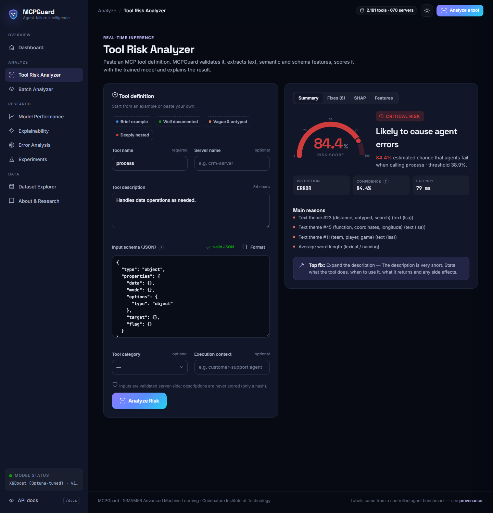
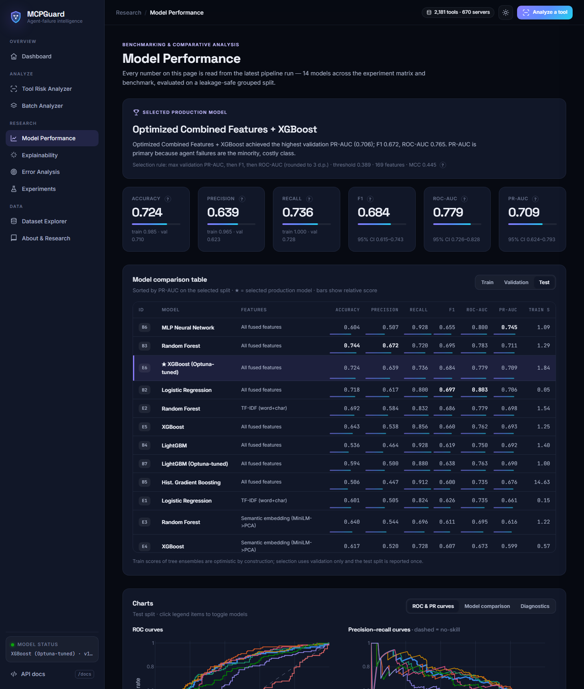

<div align="center">


# MCPGuard

### Predicting Which MCP Tool Descriptions Cause Agent Errors
**An Explainable Machine Learning Framework for Detecting High-Risk Model Context Protocol Tool Descriptions**

*Predict. Explain. Prevent agent failures.*

19MAM56 Advanced Machine Learning Lab · CAT II Project · Coimbatore Institute of Technology

**Live demo:** [https://nishanth0811-mcpguard.hf.space](https://nishanth0811-mcpguard.hf.space) · **Gradio UI:** [https://nishanth0811-mcpguard.hf.space/gradio](https://nishanth0811-mcpguard.hf.space/gradio) · **API docs:** [https://nishanth0811-mcpguard.hf.space/docs](https://nishanth0811-mcpguard.hf.space/docs) · **Code:** [https://github.com/NishanthAruchamy0927/MCPGuard](https://github.com/NishanthAruchamy0927/MCPGuard)

</div>

---

## Problem
AI agents use external systems through **Model Context Protocol (MCP)** tools. An agent knows a tool only through its **name, natural-language description and JSON input schema**. Vague wording, undocumented parameters, missing constraints and deeply nested schemas lead agents to pick the wrong tool, omit required arguments or send invalid values. These failures are expensive to debug once tools are live.

## Research question
> **Can machine learning identify high-risk MCP tool descriptions *before* they are deployed to AI agents, and explain which textual, semantic and structural properties drive that risk?**

## Objectives
1. Build a reproducible, provenance-labelled dataset of MCP tool definitions with **measured** failure labels.
2. Engineer text, semantic-embedding, schema and risk features, with dimensionality reduction.
3. Benchmark baseline and advanced models; tune with Optuna; track every run.
4. Explain predictions with SHAP and turn them into documentation fixes.
5. Serve real-time and batch inference through a validated FastAPI service and dashboard, in Docker.

## Key contributions
- **A controlled agent benchmark** (`src/data/harness.py`) that labels each tool by running a documentation-bounded agent on **real BFCL user queries and gold calls**, with BFCL-style call validation. No label is assigned by hand.
- **Multimodal feature fusion:** TF-IDF/LSA, all-MiniLM-L6-v2 → PCA, 26 schema statistics, 25 lexical statistics and 6 interpretable risk scores with documented formulas.
- **A rigorous evaluation:** a leakage-safe grouped split, 14 models, Optuna, 95% bootstrap CIs, paired significance tests, a feature-family ablation, calibration and slice-based error analysis.
- **Explainable recommendations:** SHAP drivers plus a rule layer that prioritises fixes the model itself flags.
- **A polished research console**, served by FastAPI, with nine pages and live, never-hard-coded metrics.

## Architecture


```
Browser ──► FastAPI (backend/app) ──► Inference pipeline (src/inference)
              │  REST + /docs            ├─ validation (Pydantic)
              │  static dashboard        ├─ preprocessing (text + JSON-schema)
              │  SQLite / PostgreSQL     ├─ features: TF-IDF→LSA · MiniLM→PCA · schema · risk
              │                          ├─ Optuna-tuned gradient boosting
              └─ artefacts (cached)      └─ SHAP → risk band → recommendations
```

## Dataset
| Provenance | Content |
|---|---|
| `REAL_TOOL_DEFINITION` | BFCL v3 functions (Apache-2.0) **with real user questions and gold calls**, converted to MCP format; MCP reference-server tools (filesystem, git, github, slack, …) |
| `CONTROLLED_BENCHMARK` | Every label: 10 simulated agent episodes per tool → `failure_rate`, `agent_success_rate`, `error_occurred` (≥ 0.30), `error_severity`, `error_type` |
| `SYNTHETIC_AUGMENTED` | Variants from 9 documented operators (8 degradations, 1 enrichment), kept in their seed's lineage |

Details: [`docs/DATASET_CARD.md`](docs/DATASET_CARD.md) · preprocessing decisions: [`docs/PREPROCESSING.md`](docs/PREPROCESSING.md).

## Feature engineering
See [`docs/FEATURES.md`](docs/FEATURES.md). It covers every feature family and the formulas of the six risk scores (ambiguity, missing constraints, parameter complexity, schema complexity, description quality, instruction clarity).

## Models
Baselines: majority/prior, documentation-quality heuristic, TF-IDF + Logistic Regression, TF-IDF + Random Forest.
Advanced: XGBoost, LightGBM, Histogram Gradient Boosting, MLP and Random Forest/LR on fused features, plus **Optuna-tuned XGBoost and LightGBM**.
Imbalance: cost-sensitive weights + a validation-tuned threshold (no SMOTE on embeddings).
Selection: validation **PR-AUC → F1 → ROC-AUC**.

## Hyperparameter optimization
Optuna TPE sampler with median pruning maximises mean average precision over 4-fold **stratified grouped CV inside the training split** (40 XGBoost and 30 LightGBM trials). Trials are saved to `artifacts/experiments/optuna_*_trials.csv`.

## Explainability
SHAP TreeExplainer gives global importance, a beeswarm, per-family shares and local explanations for every tool, plus the analyzer's live explanation. LSA text components are labelled with their top terms. Tests check that SHAP values sum exactly to the model logit.

## Error analysis
TP/TN/FP/FN example tables with SHAP drivers and an automatic "possible reason", slice analysis (failure mode, source, description length, parameter count, BFCL category) and an automated summary of the most common source of mistakes.

## Results
<!-- RESULTS:START -->
*Auto-generated from the latest pipeline run (2026-10-12). Labels: controlled agent benchmark.*

**Selected production model:** Optimized Combined Features + XGBoost: test **PR-AUC 0.709** (95% CI [0.624, 0.793]), ROC-AUC 0.779, F1 0.684, MCC 0.445 (threshold 0.389). No-skill PR-AUC = 0.406; documentation-quality heuristic = 0.416.

**Benchmark (held-out test split, `*` = selected)**

| ID | Model / features | Accuracy | Precision | Recall | F1 | ROC-AUC | PR-AUC |
|---|---|---|---|---|---|---|---|
| B6 | Combined Features + MLP Neural Network | 0.604 | 0.507 | 0.928 | 0.655 | 0.800 | 0.745 |
| B3 | Combined Features + Random Forest | 0.744 | 0.672 | 0.720 | 0.695 | 0.783 | 0.711 |
| E6 * | Optimized Combined Features + XGBoost | 0.724 | 0.639 | 0.736 | 0.684 | 0.779 | 0.709 |
| B2 | Combined Features + Logistic Regression | 0.718 | 0.617 | 0.800 | 0.697 | 0.803 | 0.706 |
| E2 | TF-IDF + Random Forest | 0.692 | 0.584 | 0.832 | 0.686 | 0.779 | 0.698 |
| E5 | Combined Features + XGBoost | 0.643 | 0.538 | 0.856 | 0.660 | 0.762 | 0.693 |
| B4 | Combined Features + LightGBM | 0.536 | 0.464 | 0.928 | 0.619 | 0.750 | 0.692 |
| B7 | Optimized Combined Features + LightGBM | 0.594 | 0.500 | 0.880 | 0.638 | 0.763 | 0.690 |
| B5 | Combined Features + Hist. Gradient Boosting | 0.506 | 0.447 | 0.912 | 0.600 | 0.735 | 0.676 |
| E1 | TF-IDF + Logistic Regression | 0.601 | 0.505 | 0.824 | 0.626 | 0.735 | 0.661 |
| E3 | Semantic Embedding + Random Forest | 0.640 | 0.544 | 0.696 | 0.611 | 0.695 | 0.616 |
| E4 | Semantic Embedding + XGBoost | 0.617 | 0.520 | 0.728 | 0.607 | 0.673 | 0.599 |
| B1 | Doc-quality heuristic (rule) | 0.406 | 0.405 | 0.984 | 0.573 | 0.492 | 0.416 |
| B0 | Majority / prior baseline | 0.406 | 0.406 | 1.000 | 0.577 | 0.500 | 0.406 |

**Ablation (XGBoost, 5-fold grouped CV)**

| Set | Families | #feat | CV PR-AUC | CV ROC-AUC | Test PR-AUC |
|---|---|---|---|---|---|
| A | Text (LSA) + Lexical / naming | 89 | 0.656 ± 0.051 | 0.729 | 0.656 |
| B | Schema structure | 26 | 0.643 ± 0.034 | 0.697 | 0.640 |
| C | Semantic embedding | 48 | 0.619 ± 0.056 | 0.710 | 0.599 |
| D | Text (LSA) + Lexical / naming + Schema structure | 115 | 0.684 ± 0.041 | 0.752 | 0.694 |
| E | Semantic embedding + Schema structure | 74 | 0.664 ± 0.033 | 0.747 | 0.671 |
| F | Text (LSA) + Lexical / naming + Schema structure + Engineered risk scores + Semantic embedding | 169 | 0.690 ± 0.042 | 0.756 | 0.693 |

Feature fusion vs. best single family (Text (LSA) + Lexical / naming): +0.033 PR-AUC.

**Error analysis.** Most common source of model mistakes: missed failures whose dominant benchmark failure mode is invalid arg value (52% of false negatives).

Paired bootstrap tests, calibration and all figures: `artifacts/reports/results_tables.md`, `artifacts/figures/`.
<!-- RESULTS:END -->

## Installation
```bash
git clone <repo-url> mcpguard && cd mcpguard
python -m venv .venv && source .venv/bin/activate          # Windows: .venv\Scripts\activate
pip install torch==2.14.1 --index-url https://download.pytorch.org/whl/cpu
pip install -r requirements.txt
```
`<repo-url>` is a placeholder for your GitHub URL; skip the clone if you already have the folder.
Windows PowerShell 5.1 has no `&&`, so run the steps one per line:
```powershell
python -m venv .venv
.venv\Scripts\Activate.ps1
pip install torch==2.14.1 --index-url https://download.pytorch.org/whl/cpu
pip install -r requirements.txt
```

## Running locally
```bash
python -m src.pipeline.run_all            # full pipeline (download → … → figures → report), ~20 min CPU
uvicorn backend.app.main:app --port 7860  # dashboard: http://localhost:7860 · API docs: /docs, /redoc
pytest -q                                 # tests
```
Individual stages:
```bash
python -m src.data.download          python -m src.training.optimize
python -m src.data.build_dataset     python -m src.training.train
python -m src.data.preprocess        python -m src.explainability.generate
python -m src.features.build         python -m src.evaluation.evaluate
python -m src.visualization.figures  python -m src.reporting.report
```
Or use `make data | optimize | train | evaluate | pipeline | run | test | docker`.

## Docker
```bash
docker compose up --build            # http://localhost:7860
```
The image is non-root, has a health check, and bakes in the model and embedding weights.

## Hugging Face deployment
**Live:** [https://nishanth0811-mcpguard.hf.space](https://nishanth0811-mcpguard.hf.space) (Space: [https://huggingface.co/spaces/Nishanth0811/MCPGuard](https://huggingface.co/spaces/Nishanth0811/MCPGuard)).

Hugging Face now restricts the Docker SDK to paid plans, so the public Space uses the free **Gradio SDK**: the front-matter above points it at [`space_app.py`](space_app.py), which serves the full FastAPI app (dashboard at `/`, REST API, `/docs`) and mounts a Gradio analyzer at `/gradio`. The same image also runs anywhere with Docker (`docker compose up --build`). Steps, plus AWS App Runner and GCP Cloud Run options, are in [`docs/DEPLOYMENT.md`](docs/DEPLOYMENT.md).

## API documentation
| Method | Endpoint | Purpose |
|---|---|---|
| GET | `/health` | Liveness + model status |
| POST | `/predict` | Score one tool (risk, SHAP, recommendations) |
| POST | `/batch-predict` | Score a JSON list of tools |
| POST | `/batch-predict/file` | Upload CSV/JSON; `?format=csv` returns a downloadable CSV |
| GET | `/model-metrics` | Benchmark, evaluation, curves, ablation |
| GET | `/feature-importance` | Global SHAP |
| GET | `/dataset-summary` · `/dataset/tools` · `/tools/{id}` | Dataset statistics, filterable table, tool detail + local SHAP |
| GET | `/error-analysis` · `/experiments` · `/model-info` · `/projections` | Research artefacts |
| POST | `/reload-model` | Hot-reload artefacts (optional `X-Admin-Token`) |

Interactive docs: **`/docs`** (Swagger UI) and **`/redoc`**.

Example request:
```bash
curl -X POST localhost:7860/predict -H "Content-Type: application/json" -d '{
  "tool_name": "search_customer",
  "description": "Searches for a customer using customer ID.",
  "input_schema": {"type": "object",
                   "properties": {"customer_id": {"type": "string", "description": "Unique customer identifier"}},
                   "required": ["customer_id"]}}'
```

## Project structure
```
├── app/                  single-process launcher (python -m app.main)
├── backend/app/          FastAPI: api/ schemas/ services/ database/ main.py
├── frontend/             dashboard (index.html, static/css, static/js/pages/*)
├── src/
│   ├── data/             download, MCP reference tools, augmentation, harness, dataset builder
│   ├── preprocessing/    text + JSON-schema processing, cleaning
│   ├── features/         risk features, embeddings, fused feature builder
│   ├── models/           model registry
│   ├── training/         split, Optuna, training orchestrator, tracking
│   ├── evaluation/       metrics, bootstrap tests, error analysis
│   ├── explainability/   SHAP, recommendation engine
│   ├── inference/        real-time predictor
│   ├── visualization/    report figures + projections
│   ├── reporting/        tables + IEEE report filling
│   └── pipeline/         run_all
├── configs/config.yaml   every tunable value
├── data/                 raw/ processed/ external/ metadata/ dataset_card.md
├── models/               best_model.joblib, preprocessor.joblib, tfidf_vectorizer.joblib, *.json
├── artifacts/            figures/ metrics/ experiments/ reports/
├── docs/                 model & dataset cards, features, deployment, literature, report/
├── notebooks/  tests/  scripts/
└── Dockerfile  docker-compose.yml  requirements*.txt  Makefile  LICENSE
```

## Screenshots
Screenshots of the dashboard are in `docs/screenshots/` (regenerate with `scripts/screenshots.sh` while the server is running).

| Dashboard | Tool Risk Analyzer |
|---|---|
|  |  |
| **Model Performance** | **Explainability** |
|  |  |

## Limitations
- **Labels come from a simulated agent**, calibrated once to the range of BFCL-reported AST error rates. It is a controlled benchmark, not production telemetry.
- Some failure modes (sibling-tool routing, user phrasing, server strictness) are not observable from a single description; the error analysis quantifies this.
- The corpus is English and BFCL-heavy.

## Future work
Relabel with real LLM agents (pass@k across models); closed-loop LLM description rewriting re-scored by MCPGuard; cross-agent calibration; active learning from production logs.

## References
See [`docs/REFERENCES.md`](docs/REFERENCES.md) (IEEE style) and [`docs/LITERATURE_REVIEW.md`](docs/LITERATURE_REVIEW.md). The report is in [`docs/report/`](docs/report/).
